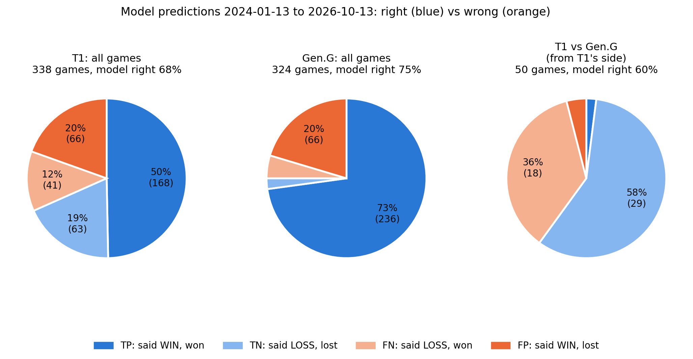

# LoL matchup analyst

Type two teams, get a report: win probability, what drives it, lineups, head-to-head, recent form,
and how often the model has been right about these teams (with pie charts).

## Use it

In WSL, inside the venv, from `05_analyst/`:

```bash
pip install pandas numpy scikit-learn matplotlib
python export_data.py                 # once, and after each data refresh: writes data/ (about 3 MB, about 1 minute)
python lol_analyst.py "T1" "Gen.G"
```

| Option | Does |
|---|---|
| `--bo 1/3/5` | series length (default 3) |
| `--odds 1.80 2.05` | compare with bookmaker decimal odds, team A first |
| `--a-roster "Zeus,Oner,Faker,Gumayusi,Keria"` | override a lineup (top, jng, mid, bot, sup), e.g. a stand-in |
| `--data-dir DIR` | read the data from another folder |
| `--date 2026-11-01` | analyse as of another date (Elo yearly reset, years as a pro) |
| `--list-teams [text]` | teams with a game in the last 12 months |
| `--no-range`, `--no-plot`, `--out DIR` | skip the 90% range / the PNG; folder for the PNG (default `./reports`) |

## The report

1. **Win probability**: one game (side-neutral), Bo1/Bo3/Bo5, 90% range (200 bootstrap refits), blue-side effect, and the track record: how often the model's favourite won at about that confidence.
2. **Why**: the 12 factors for both teams and how many probability points each moves the result, grouped as lineup strength (player Elo), recent in-game form (last 10 games) and experience.
3. **Lineups**: each team's last starting five with player Elo and major-league games; rookie and NEW (stand-in) flags.
4. **Head to head**: team record and the last six series since 2021; lane-by-lane record for the two players facing each other.
5. **Recent form**: last 10 results, streak, Elo change, days since the last game.
6. **Market** (with `--odds`): the bookmaker's margin-free probability against the model.
7. **True/false positives**: from walk-forward predictions (each made by a model trained only on earlier years, 2024 onward), for team 1, team 2 and team 1 vs team 2. Positive = the model said the team wins. TP said win and won, FP said win and lost, TN said loss and lost, FN said loss and won. Printed as a table and saved as three pie charts.



## How the probability is computed

A logistic regression on 12 pre-draft factors, each measured as team A minus team B: player Elo of the five starters; gold spread,
ward clearing, vision score, first-tower and first-dragon rate over the last 10 games; career, major-league, playoff and international
games, years as a pro, and rookies. It is trained on every major-league game since 2022 (10,594 games) each time the app runs.
`P(A wins) = 1 / (1 + exp(-sum of weight x scaled difference))`. Series: `Bo3 = p²(3-2p)`, `Bo5 = p³(10-15p+6p²)`, games assumed independent.

## Data (`data/`, local only, not in git)

| File | Rows | Content |
|---|---|---|
| `train.csv.gz` | 10,594 | training table: game, date, league, teams, result, the 12 factors |
| `predictions.csv.gz` | 6,602 | walk-forward predictions 2024 onward (`p_blue` = model probability that blue wins) |
| `teams.csv` | 115 | team Elo, recent form (`form_*`, last 10 games), last game |
| `players.csv` | 9,283 | player Elo, games played (all, major, playoffs, international), first and last game |
| `lineups.csv` | | last starting five per team |
| `games.csv.gz` | 14,371 | every major-league and international game since 2021 |
| `lanes.csv.gz` | | every same-lane meeting of two players since 2021 |
| `manifest.json` | | data date, model settings, file list |

Source: [Oracle's Elixir](https://oracleselixir.com) match data, processed by this project. Covers LCK, LPL, LEC, LCS, CBLOL, LCP and the international events since 2021.

## Refresh the data

1. Put the newest Oracle's Elixir CSVs in `01_data/` and rebuild `02_features/` (`build_features.py`, `roster_features.py`, `experience_features.py`).
2. `cd 05_analyst && python export_data.py` (rebuilds the snapshot with `state.py` and writes `data/`).
3. Optional check: `python validate_snapshot.py` rebuilds the snapshot before past games and compares the 12 factors with the training values (all differences 0.000 on the games tested).

## Limits

- Pre-draft only: the draft, patches, injuries and scrim form are not included.
- Cross-region matchups are rough: ratings are earned mostly inside each league (the app prints a warning).
- Team names in the true/false-positive charts follow the current name; games played under an older name are not counted.
- In every test of this project the bookmaker's closing odds were a better forecast than this model. It is an analysis tool, not betting advice.
