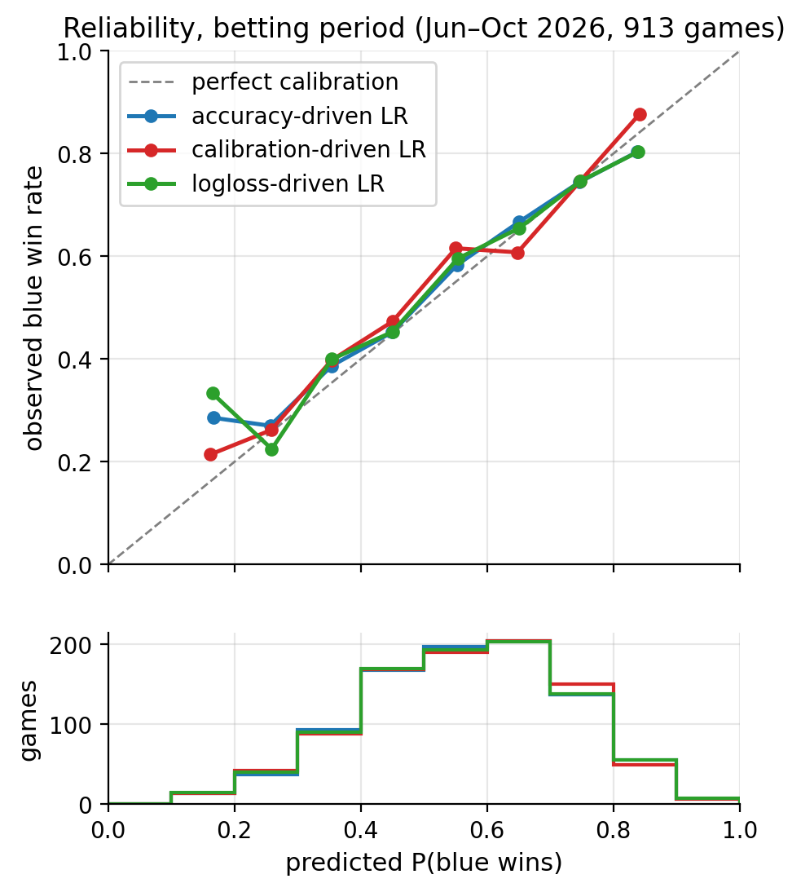
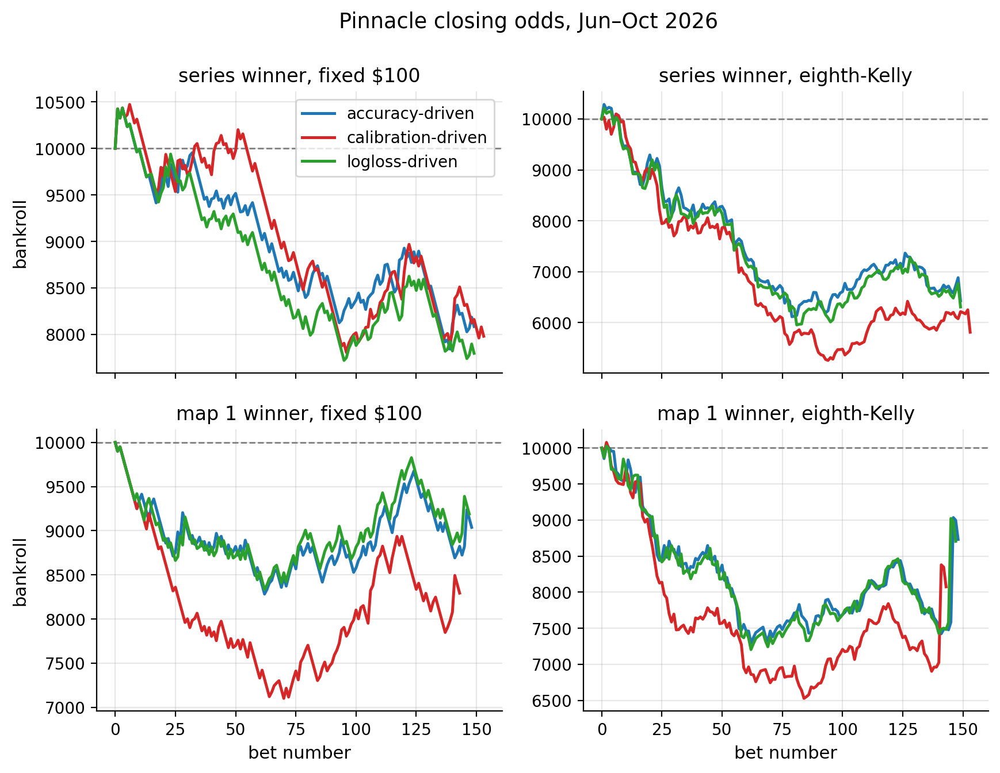
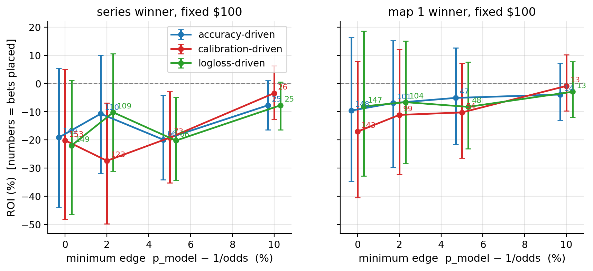

# Calibration vs accuracy for LoL esports betting

Reproducing Walsh & Joshi (2024), *"Machine learning for sports betting: should model selection be based on accuracy or calibration?"*, on professional League of Legends (LCK, LPL, LEC, LCS, CBLOL, LCP, 2024–2026) instead of the NBA.

## Status

| Stage | Folder | State |
|---|---|---|
| 1. Raw data (Oracle's Elixir, 2024–2026) | `01_data/` | ✅ done |
| 2. Feature building (blue − red, past games only, Elo) | `02_features/` | ✅ done: 6,477 games, 17 features |
| 3. Model selection (accuracy / ECE / log-loss branches) + series probabilities | `03_model_selection/` | ✅ done |
| 4. Historical odds (OddsPapi: series winner + map-1 winner) | `04_odds/` | ✅ done: 250 series Jun–Oct 2026, Pinnacle odds for 243 |
| 5. Betting simulation (fixed stake, fractional Kelly) | `05_betting_simulation/` | ✅ 3 branches × 2 markets × 2 stakes × 4 edge thresholds: no system beats Pinnacle |

---

## Introduction

### Betting in one page

A bookmaker offers **decimal odds** $o$: a stake of 1 returns $o$ if the bet wins (stake + profit $o-1$), and 0 if it loses.

- **Implied probability**: $\pi = 1/o$. Odds of 2.50 mean the bookmaker prices the outcome at 40 %.
- **Margin (overround)**: for a two-way market $1/o_1 + 1/o_2 > 1$. The excess (typically 3–6 %) is the bookmaker's commission. Fair odds on a coin flip are 2.00/2.00; a bookmaker offers 1.90/1.90, so $2/1.90 = 1.053$, a 5 % margin.
- **Expected value** of a unit bet, if the true win probability is $p$:

$$\mathrm{EV} = p\,o - 1 .$$

- **Value bet**: $\mathrm{EV} > 0 \iff p > 1/o$. A bettor can only find value bets with a model whose $p$ is *closer to the truth* than the bookmaker's $\pi$.

### Why it matters

Most sports-prediction papers pick the model with the highest **accuracy** (share of winners predicted correctly). But a betting decision does not use the predicted winner; it uses the **number** $p$, compared against $1/o$. A model can be accurate yet badly over- or under-confident, and then it finds "value" that is not there. The paper argues that **calibration** (how honest the probabilities are) is what should drive model selection, and reports +34.7 % vs −35.2 % average ROI on one NBA season.

### Accuracy vs calibration

Two models, one game whose true blue-win probability is 60 %:

| Model | Says | Picks the winner? | Honest? |
|---|---|---|---|
| A | 60 % | yes | yes |
| B | 95 % | yes | no, over-confident |

Accuracy cannot tell A from B. If the odds imply 70 %, A correctly passes and B bets on a negative-EV outcome.

**Calibration.** A model is perfectly calibrated if, among all games where it says $p$, the event happens a fraction $p$ of the time:

$$P(Y = 1 \mid \hat p = p) = p \quad \forall p\in[0,1].$$

**Expected calibration error (ECE).** Split $[0,1]$ into $M$ equal bins $B_1,\dots,B_M$ (the paper uses $M = 20$). With $n$ predictions,

$$\mathrm{ECE} = \sum_{j=1}^{M} \frac{|B_j|}{n}\,\Big|\,\bar y(B_j) - \bar p(B_j)\,\Big| ,$$

where $\bar y(B_j)$ is the observed win rate and $\bar p(B_j)$ the mean predicted probability in bin $j$. For a binary outcome the paper's *classwise*-ECE equals this ECE on the positive class.

**The loophole.** Predicting the base rate (blue wins ≈ 54 %) for every game gives ECE ≈ 0 and is useless. The paper's patch: if fewer than 80 % of the bins are non-empty, ECE is set to 1. We keep this rule, and we also report **log-loss** and **Brier score**, which are *proper scoring rules*: they reward probabilities that are both honest and informative, and cannot be gamed by predicting the base rate.

$$\text{log-loss} = -\frac1n\sum_i\big[y_i\ln\hat p_i + (1-y_i)\ln(1-\hat p_i)\big],\qquad \text{Brier} = \frac1n\sum_i(\hat p_i - y_i)^2 .$$

**Kelly staking.** For a bet at odds $o$ ($b = o-1$) with win probability $p$, the stake fraction that maximises long-run log-wealth is

$$k^\* = \frac{p\,b - (1-p)}{b}.$$

Full Kelly is very aggressive when $p$ is wrong, so the paper bets $k^\*/8$ ("eighth-Kelly"). Kelly makes calibration matter *more*: an over-confident $p$ inflates both the number of bets and their size.

### The model we ended up with: logistic regression

Both branches of the pipeline selected **logistic regression (LR)**; RF, SVM and MLP were not better on the test months.

**Model.** For a game with feature vector $x$ (blue − red differences, standardised), LR says the **log-odds** of a blue win are linear in the features:

$$\ln\frac{p}{1-p} = \beta_0 + \beta^\top x \quad\Longleftrightarrow\quad p = \sigma(\beta_0 + \beta^\top x) = \frac{1}{1 + e^{-(\beta_0 + \beta^\top x)}} .$$

- $\beta_0$ is the side effect: when the two teams are equal ($x = 0$), $p = \sigma(\beta_0)$.
- $\beta_k$: one standard deviation more of feature $k$ multiplies the odds of a blue win by $e^{\beta_k}$.

**Fitting.** $\beta$ minimises the log-loss above plus an L2 penalty,

$$\min_{\beta_0,\beta}\; \sum_i \text{log-loss}_i + \frac{1}{2C}\,\lVert\beta\rVert^2 ,$$

where $C$ is the one hyperparameter the tuner chose (smaller $C$ = stronger shrinkage toward $p = \sigma(\beta_0)$). Because LR is trained *directly on log-loss*, a proper scoring rule, it tends to come out well calibrated without extra steps; this is a classic reason LR is a strong baseline for probability forecasting.

**What the accuracy-driven LR learned** (trained on 2024 – May 2026, $C = 0.196$):

| Feature (blue − red) | 1 SD = | $\beta$ (per SD) | Odds ratio $e^{\beta}$ |
|---|---|---|---|
| intercept (equal teams) | – | +0.143 | $p = 0.536$, the blue-side edge |
| Elo rating | 129 Elo points | **+0.714** | 2.04 |
| dragon edge (last 10 games) | 1.4 dragons | +0.119 | 1.13 |
| ward-clear-per-minute edge | 0.27 | +0.103 | 1.11 |
| first-blood rate | 0.24 | +0.042 | 1.04 |
| Baron edge | 0.67 | −0.042 | 0.96 |
| first-dragon rate | 0.25 | −0.062 | 0.94 |

Elo dominates: a blue team rated 129 points higher has twice the odds of winning. The small negative coefficients belong to features that overlap with Elo and dragon edge (they correct for double counting rather than meaning "first dragons are bad").

**From games to series.** Bookmakers price the series. With per-game probability $p$ for team A (averaged over blue and red side) and games treated as independent,

$$P_{\text{Bo1}} = p,\qquad P_{\text{Bo3}} = p^2(3-2p),\qquad P_{\text{Bo5}} = p^3(10-15p+6p^2).$$

---

## Literature review

Full notes: [`Literatures/literature_review.md`](Literatures/literature_review.md).

| Paper | What it did | What it leaves open |
|---|---|---|
| **Walsh & Joshi 2024** (anchor) | NBA; two pipelines that select features, hyperparameters and model by accuracy vs by classwise-ECE; eighth-Kelly betting on 2018/19; calibration-driven ROI +34.7 % vs −35.2 % | One season, no significance test; ECE loophole patched by an arbitrary 80 %-bins rule; no proper scoring rule; only the NBA |
| Hubáček, Šourek & Železný 2019 | NBA; loss that penalises correlation with bookmaker odds beats optimising accuracy | Not framed as calibration; same single sport |
| Guo et al. 2017 | Modern neural nets are over-confident; introduces temperature scaling, popularises ECE | Not about decisions or betting |
| Kull et al. 2019 | Classwise-ECE and Dirichlet calibration; notes ECE can be gamed by predicting the class distribution | Not about betting |
| Kelly 1956 / Hsieh & Barmish 2015 | Optimal log-growth stake; full Kelly leads to near-certain ruin with model error, fractional Kelly is safer | Assumes $p$ is known |

### The gap

- Walsh & Joshi: evidence from **one sport, one season**, no uncertainty estimate.
- ECE as a *selection* criterion can prefer a **less informative** model (it rewards hugging the base rate).
- Esports markets are younger and possibly less efficient, but untested with this method.

**Overall gap:** it is not known whether calibration-based model selection beats accuracy-based selection outside the NBA, and whether ECE is the right calibration criterion compared to proper scoring rules.

| Gap | Statement |
|---|---|
| G1 | The accuracy-vs-calibration result has only been shown on one NBA season. |
| G2 | ECE-based selection can favour uninformative models; proper scoring rules (log-loss) are untested as the selection criterion in this setting. |
| G3 | Game-level models must be mapped to series-level betting markets in esports. |

### Research questions

| | Question | Gap | Hypothesis |
|---|---|---|---|
| RQ1 | Does calibration-driven model selection give a higher betting ROI than accuracy-driven selection on LoL (Jun–Oct 2026)? | G1 | **H1.** Yes, as in the NBA paper. |
| RQ2 | Does selecting by log-loss beat both? | G2 | **H2.** Log-loss-driven selection is at least as profitable as ECE-driven, because ECE can reward under-confident models. |
| RQ3 | Does betting on series (via $P_{\text{Bo}n}$) or on map 1 directly give better-calibrated decisions? | G3 | **H3.** Map-1 bets are better matched to a game-level model. |

**Novelty**

| | Contribution | Gap |
|---|---|---|
| N1 | First test of the calibration-vs-accuracy selection question on esports, 6 leagues | G1 |
| N2 | Side-by-side ECE vs log-loss as the selection criterion | G2 |
| N3 | Game → series probability mapping tested against real series odds | G3 |

*Limits on the novelty claim:* this is a reproduction study on one betting period (≈ 320 series); results are a case study, not a general proof.
*If the hypotheses fail:* a negative result on H1 is still informative: it would show the NBA result does not transfer, and the reliability plots show *why*.

### Scope

Exactly what G1–G3 require:

| In scope | Needed for |
|---|---|
| Team-level features from Oracle's Elixir, 6 leagues, 2024–2026 | G1 |
| Accuracy / ECE / (log-loss) selection branches | G1, G2 |
| Pinnacle closing odds, series winner + map-1 winner | G1, G3 |
| Fixed-stake and eighth-Kelly simulation | G1 |

Not in the current scope: player-level features, draft/champion features, live (in-game) betting, international events.
Deferred: retraining every split on the two previous splits; bootstrap confidence intervals on ROI.

---

## Methods

### Settings

| | |
|---|---|
| Data | Oracle's Elixir match CSVs 2024–2026, team rows only; LCS, LEC, LCK, LPL, CBLOL, LCP (2025 LTA N → LCS, LTA S → CBLOL) |
| Label | `blue_win` (blue side wins ≈ 54 %) |
| Split (time order, never shuffled) | train 2024 · validation 2025 · test Jan–May 2026 · betting Jun–Oct 2026 |
| Odds | OddsPapi historical odds, Pinnacle closing price; market 181 (series winner), 1847 (map-1 winner) |

### Stage 2: features (`02_features/build_features.py`)

1. Per game, each team's **edge** = team − opponent (kills − deaths, dragons, grubs, Barons, towers, inhibitors, damage/min, vision/min, gold/min, ward clears/min, gold-spent diff, first blood/dragon/tower, game length, win).
2. **Rolling mean of the previous 10 games** (`shift(1)`: the current game never sees itself), at least 5 past games required.
3. **Elo** (K = 24, 25 % reset toward 1500 each new year).
4. Game row = blue − red. @15-min stats, CS/min, first Herald and first Baron are excluded because LPL lacks them.

### Stage 3: model selection (`03_model_selection/pipeline.py`)

| Step | Accuracy branch | Calibration branch |
|---|---|---|
| A. Covariate shift: KS test train vs validation | drop if $p < 0.01$ **and** $D > 0.15$ (shared) | same |
| B. Redundancy: Spearman $\lvert\rho\rvert > 0.7$ → keep the one most correlated with the label | shared | shared |
| C. Sequential forward selection with LR, run to completion | max accuracy | min ECE (20 bins, ≥ 80 % filled) |
| D. Bayesian optimisation (TPE, Optuna), 40 trials × 3 seeds, for LR / RF / SVM / MLP | max accuracy | min ECE |
| E. Refit on train + val, choose best on test | highest accuracy | lowest ECE |

Deviation from the paper: with ~2,000 games per year the KS test rejects almost every feature at $p < 0.01$ (it dropped Elo and accuracy fell to 59 %), so a minimum effect size $D > 0.15$ was added.

`series_probs.py` converts the chosen models' game probabilities into series probabilities (formulas above). Best-of is inferred from the score.

**Checks:** reliability diagram (`assets/reliability_bet.png`); bet-period metrics computed once, after all choices were frozen.

### Stage 4–5: odds and simulation (planned)

Match OddsPapi fixtures to Oracle series by date and team names; bet whenever $p > 1/o$ (value bet); stakes: fixed 100 and eighth-Kelly from a 10,000 bankroll; report ROI, number of bets, and bootstrap intervals.

---

## Results so far

**Selected features**

- Accuracy branch: Elo, dragon edge, first-dragon rate, ward-clear edge, Baron edge, first-blood rate
- Calibration branch: damage/min edge, first-dragon rate, game length (Elo was *not* chosen)
- Log-loss branch: Elo, dragon edge, grub edge, ward-clear edge, first-tower rate, vision/min edge (LR, $C = 0.039$)

**Test set (Jan–May 2026, 1,460 games), all candidates**

| Branch | Model | Accuracy | ECE | Log-loss | Brier |
|---|---|---|---|---|---|
| accuracy | **LR** | **0.628** | 0.056 | **0.651** | **0.229** |
| accuracy | RF | 0.622 | 0.059 | 0.658 | 0.232 |
| accuracy | SVM | 0.625 | 0.052 | 0.653 | 0.230 |
| accuracy | MLP | 0.626 | 0.068 | 0.656 | 0.230 |
| calibration | **LR** | 0.606 | 0.037 | 0.665 | 0.235 |
| calibration | RF | 0.612 | 0.041 | 0.669 | 0.237 |
| calibration | SVM | 0.607 | 0.038 | 0.664 | 0.235 |
| calibration | MLP | 0.610 | 0.029 (only 75 % bins → rejected) | 0.663 | 0.235 |

**Betting period (Jun–Oct 2026), final models**

| | Accuracy-driven LR | Calibration-driven LR |
|---|---|---|
| Game accuracy (913 games) | **63.8 %** | 60.0 % |
| ECE | 3.85 % | **3.43 %** |
| Log-loss | **0.637** | 0.660 |
| Series accuracy (323 series) | **68.4 %** | 62.5 % |



Both models track the diagonal. The calibration-driven model has a narrower spread of predictions (the histogram), which is how it gets its lower ECE; the accuracy-driven model is slightly over-confident above 0.85. Baseline: always predicting blue gives ≈ 54 %.

### Update: 2021–2023 data added (train 2022–2024, 2021 = warm-up)
All features rebuilt from Oracle's Elixir 2021–2026 (11,788 major-league games, was 6,767). 2021 is used only to
warm up Elo, rolling stats and player histories; training is 2022–2024 (5,921 games, was ~2,000), validation 2025,
test and betting periods unchanged. Old results are kept in `_backup_2024start/`.
Notes: no complete LPL games in 2021 (LPL warms up in 2022); LCP did not exist before 2025 (cold start, as before);
`f_grub_edge` is now dropped by the KS test (grubs exist only from 2024). **This run tuned LR only**
(`pipeline.py --models LR`): LR won every branch before, and SVM tuning on 6k games takes hours on 2 CPUs.
The SVM solver is now capped at 10⁶ iterations for when the full search is rerun.

| | old (train 2024) | new (train 2022–24) |
|---|---|---|
| bet-period game log-loss, accuracy / calibration / log-loss branch | 0.6367 / 0.6598 / 0.6359 | 0.6327 / 0.6358 / 0.6331 |
| series log-loss on 224 matched series (best branch) vs Pinnacle 0.5748 | ≈ 0.605 | 0.6017 |
| map-1 log-loss on 216 games (best branch) vs Pinnacle 0.6529 | ≈ 0.667 | 0.6672 |
| draft experiment, best all-2026 log-loss | 0.6367 (G) | 0.6336 (H) |
| experience: team Elo base → + all experience | 0.6451 → 0.6405 | 0.6414 → 0.6376 |

- More data helps everywhere, most in Jan–Mar (warm-up), and it rescues the calibration branch (it now picks Elo).
- **Betting is still negative in every configuration**; the single positive cell of the old run (map 1, calibration, eighth-Kelly, +13 %) is now −19 %, confirming it was noise. Pinnacle is still clearly sharper.

### Betting simulation (Jun–Oct 2026, Pinnacle closing odds)

225 of 323 series matched to odds (game 1 present, price taken ≥ 60 min before game 1, 2 fixtures with contradictory series/map-1 prices removed). 95 % intervals: 2,000 bootstrap resamples of the series.

**Is the model sharper than the market?** Log-loss on the matched series (lower = better):

| Market | Pinnacle (margin removed) | Accuracy-driven LR | Calibration-driven LR |
|---|---|---|---|
| Series winner (n = 224) | **0.575** | 0.606 | 0.676 |
| Map-1 winner (n = 216) | **0.653** | 0.672 | 0.682 |

**Returns** (bankroll 10,000; value bet = $p_{model} > 1/o$):

| Market | Branch | Rule | Bets | Bets won | ROI | 95 % CI |
|---|---|---|---|---|---|---|
| series | accuracy | fixed 100 | 167 | 52 % | −14.8 % | −41 % … +11 % |
| series | accuracy | ⅛-Kelly | 167 | 52 % | −34.8 % | −63 % … +13 % |
| series | calibration | fixed 100 | 203 | 37 % | −32.6 % | −69 % … +5 % |
| series | calibration | ⅛-Kelly | 203 | 37 % | −63.6 % | −90 % … +37 % |
| map 1 | accuracy | fixed 100 | 158 | 51 % | −8.8 % | −33 % … +15 % |
| map 1 | accuracy | ⅛-Kelly | 158 | 51 % | −18.6 % | −51 % … +43 % |
| map 1 | calibration | fixed 100 | 177 | 40 % | −15.8 % | −48 % … +18 % |
| map 1 | calibration | ⅛-Kelly | 177 | 40 % | +13.2 % | −57 % … +220 % |



**Reading.** Pinnacle's prices are better probabilities than either model, so the "value bets" are mostly the model's own errors, and both systems bet on 73–91 % of series (the same red flag as in the NBA paper). H1 is **not supported**: the calibration-driven model (lowest ECE) loses more, because ECE rewarded predictions squeezed toward 50 %, not closeness to the truth. Before the data cleaning, two fixtures with swapped series prices produced +200 % "profits": a single bad price can flip the conclusion, which is exactly the fragility of one-season ROI results.

### Log-loss branch (RQ2) and minimum-edge rule

A third branch selects features, hyperparameters and model by **log-loss** (min on validation / test). It again chose LR, with Elo first.

| Betting period | Accuracy-driven | ECE-driven | **Log-loss-driven** | Pinnacle |
|---|---|---|---|---|
| Game accuracy (913 games) | 63.8 % | 60.0 % | **64.8 %** | – |
| Series accuracy (323) | 68.4 % | 62.5 % | **70.3 %** | – |
| Series log-loss (224 matched) | 0.606 | 0.676 | **0.605** | **0.575** |
| Map-1 log-loss (216 matched) | 0.672 | 0.682 | **0.669** | **0.653** |

**Minimum edge.** Bet only when $p_{model} - 1/o > \delta$. Yield per dollar staked, fixed 100 stakes:

| Market | δ | Accuracy | ECE | Log-loss |
|---|---|---|---|---|
| series | 0 % | −8.9 % | −16.1 % | −7.3 % |
| series | 2 % | −7.1 % | −16.9 % | −4.0 % |
| series | 5 % | −18.3 % | −12.7 % | −13.9 % |
| series | 10 % | −11.6 % | −13.2 % | −30.9 % |
| map 1 | 0 % | −5.6 % | −8.9 % | −8.5 % |
| map 1 | 2 % | −10.8 % | −5.9 % | −13.2 % |
| map 1 | 5 % | −5.4 % | −5.7 % | −7.9 % |
| map 1 | 10 % | −5.2 % | +9.8 % (81 bets, CI includes 0) | −9.3 % |



**Reading.**
- **H2 partly supported:** log-loss selection gives the best probabilities of the three branches (best accuracy *and* best log-loss), and it loses less than ECE selection on the series market. It still does not beat Pinnacle.
- **Requiring a bigger edge does not create profit.** Yields stay around −5 % to −15 %, i.e. roughly the bookmaker margin or worse, which is what betting with *no* real edge looks like. When our model strongly disagrees with Pinnacle, it is usually our model that is wrong (rosters, substitutes, patches it cannot see). The single positive cell (ECE, map 1, δ = 10 %) has a 95 % interval that includes zero and is the kind of result one expects by chance among 24 cells.
- **Overall:** with public team stats and Elo, the models are ~0.03 log-loss worse than Pinnacle's closing line; no model-selection metric fixes that. The question "accuracy or calibration?" only matters once a model is at least as sharp as the market.

### Recency weighting (`03_model_selection/recency_experiment.py`)

Three ways to make recent matches count more, tested on the log-loss-branch LR (60 settings, chosen on the test months):

| Knob | Options | Test log-loss (others at current setting) |
|---|---|---|
| Feature averaging | mean of last 10 · EWMA half-life 3 / 5 / 10 / 20 games | 0.6498 · 0.6500 / 0.6499 / 0.6503 / 0.6504 (no effect) |
| Elo update speed $K$ | 16 / **24** / 40 | **0.6488** / 0.6498 / 0.6521 (slower Elo is better) |
| Training-sample weight $w = 0.5^{\text{age}/\tau}$ | equal / τ = 365 / 180 / 90 days | 0.6498 / 0.6495 / 0.6490 / **0.6478** |

Best combination (EWMA half-life 5, $K = 16$, τ = 90 days): test 0.6498 → 0.6465, betting period 0.6359 → 0.6345, accuracy 64.8 % → 65.1 %. Real but small: it closes about 5 % of the gap to Pinnacle. Recent *training games* matter (the meta changes), but a team's form is already captured well by the last-10 mean and a slow-moving Elo.

### Staleness and roster changes

**Walk-forward check** (`03_model_selection/walkforward_check.py`): retraining every month on all earlier games instead of once on 2024–2025 changes the Jun–Oct log-loss only from 0.6375 to 0.6362. The model does not go stale during the year; the hardest months are **Jan–Mar** (0.68–0.69, right after the off-season), the easiest Apr–Aug (0.60–0.63).

**Roster-aware features** (`02_features/roster_features.py`, `03_model_selection/roster_experiment.py`), from the player rows:

| Variant (trained on 2024–2025) | Jan–Mar | Apr–May | Jun–Oct | All 2026 |
|---|---|---|---|---|
| baseline (team Elo) | 0.6749 | 0.6284 | 0.6375 | 0.6451 |
| + roster changes, lineup familiarity | 0.6756 | 0.6288 | 0.6378 | 0.6455 |
| **player Elo** instead of team Elo | **0.6697** | **0.6263** | 0.6372 | **0.6428** |
| player Elo + roster features | 0.6712 | 0.6265 | **0.6369** | 0.6432 |

*Player Elo* (every player carries a rating; team = mean of its 5 starters, so ratings follow players between teams) helps where expected, early in the year (−0.005), and a little overall. Counting roster changes adds nothing once player Elo is in. Still ~0.03 behind Pinnacle on the series market.

### Draft features

`02_features/draft_features.py`, from the picks in the player rows, using only earlier games: champion's recent pro win rate (90 days, shrunk toward 50 %), player's experience on the champion (log games), player's win rate on it (shrunk).

| Variant (trained on 2024–2025) | Jan–Mar | Apr–May | Jun–Oct | All 2026 |
|---|---|---|---|---|
| pre-draft: player-Elo model | 0.6697 | 0.6263 | 0.6372 | 0.6428 |
| + champion meta win rate | 0.6689 | 0.6201 | 0.6349 | 0.6396 |
| + player comfort | 0.6667 | 0.6236 | 0.6352 | 0.6403 |
| **+ all draft features** | **0.6662** | **0.6182** | **0.6329** | **0.6374** |

The draft is the largest single improvement so far (−0.005 overall, −0.008 in Apr–May). **But it is only known ~10 min before the game**, so it cannot inform a pre-match series bet; only a map bet placed after the draft.

**Versus Pinnacle's map-1 price** (`05_betting_simulation/draft_vs_market.py`, 216 matched games, Jun–Oct):

| | Log-loss |
|---|---|
| our model, pre-draft | 0.6668 |
| **our model + draft** | **0.6595** |
| Pinnacle, 60 min before game 1 | 0.6529 |
| Pinnacle, 20 / 10 / 2 min before | 0.6524 / 0.6548 / 0.6548 |

The draft closes about two thirds of our gap to Pinnacle's map-1 price (0.014 → 0.005), and Pinnacle's map-1 line barely moves in the last minutes. Caveat: it is not certain whether Oracle's timestamp marks the start of the draft or of the game, so "−2 min" may still be pre-draft.

### More features: early game, per-patch strength, lane matchups, synergy

`early_features.py` (gold/XP/CS lead at 10–15 min, last 10 games; missing for LPL) and an extended `draft_features.py`:
per-patch champion win rate (shrunk toward the 90-day rate), **lane matchup** (my champion vs the exact enemy champion in the same lane, last 365 days, shrunk), **synergy** (bot+sup, jng+mid, jng+top duos together, shrunk).

| Variant (trained on 2024–2025) | Jan–Mar | Apr–May | Jun–Oct | All 2026 | Non-LPL 2026 |
|---|---|---|---|---|---|
| A pre-draft: player-Elo model | 0.6697 | 0.6263 | 0.6372 | 0.6428 | 0.6321 |
| B A + early-game stats | 0.6707 | 0.6276 | 0.6370 | 0.6434 | 0.6325 |
| C A + draft (meta, comfort) | 0.6662 | 0.6182 | 0.6329 | 0.6374 | 0.6273 |
| D C + per-patch strength | 0.6666 | 0.6184 | 0.6328 | 0.6376 | 0.6274 |
| E C + lane matchups | 0.6654 | 0.6177 | 0.6327 | 0.6370 | 0.6271 |
| F C + synergy | 0.6651 | 0.6188 | 0.6319 | 0.6369 | 0.6264 |
| **G A + all draft** | **0.6650** | 0.6185 | 0.6317 | **0.6367** | 0.6265 |
| H everything | 0.6661 | 0.6200 | **0.6316** | 0.6375 | 0.6270 |

- **Early-game stats add nothing**, even where they exist (non-LPL): a team that wins lanes also takes dragons, towers and Elo, which the model already has.
- **Per-patch strength adds nothing** beyond the 90-day champion win rate (one patch is too few games per champion).
- **Lane matchups and synergy help a little** (≈ −0.0005 each); G is the best draft model.
- Diminishing returns: after Elo and the champion meta, each new feature family gives < 0.001.

### Champion-class matchups (`02_features/class_features.py`)
Exact champion pairs are rare, so we pooled champions into the League of Legends Wiki classes
(13 subclasses in 7 classes, `02_features/champion_classes.csv`, all 173 champions covered).
**Class lane matchup**: my subclass vs the enemy subclass in the same lane (e.g. Juggernaut top vs Skirmisher top).
**Class cross matchup**: class vs class over all 25 blue × red champion pairs, to catch cross-lane counters (tank vs mage, engage vs poke).

| Variant (2026 log-loss) | Jan–Mar | Apr–May | Jun–Oct | all 2026 |
|---|---|---|---|---|
| C meta + comfort | 0.6662 | 0.6182 | 0.6329 | 0.6374 |
| I C + class lane | 0.6656 | 0.6183 | 0.6332 | 0.6374 |
| J C + class cross | 0.6655 | 0.6181 | 0.6335 | 0.6374 |
| G all draft | 0.6650 | 0.6185 | 0.6317 | 0.6367 |
| K G + both class features | 0.6644 | 0.6185 | 0.6322 | 0.6368 |

- **No gain.** Class-vs-class win rates in pro play stay very close to 50 % (cross-matchup SD 0.004), so the classes are balanced against each other; the coefficients are near zero (0.006, 0.015 per SD).
- What matters in the draft is the specific champion's current strength and the player's comfort on it, not its class.

### Which champion pairs matter? (`02_features/synergy_features.py`, `03_model_selection/synergy_experiment.py`)
Each pair as its own feature (exact champion combination on the same team, 365 days, shrunk to 50 %, blue − red),
added one at a time to the meta + comfort model (all-2026 log-loss 0.6374):

| Added | all 2026 | vs base | Jun–Oct | Apr–May |
|---|---|---|---|---|
| old f_synergy (3 duos averaged) | 0.6369 | −0.0005 | 0.6319 | 0.6188 |
| ADC + support | 0.6377 | +0.0003 | 0.6332 | 0.6185 |
| jungle + mid | 0.6377 | +0.0002 | **0.6300** | 0.6229 |
| jungle + support | 0.6374 | −0.0001 | 0.6328 | 0.6182 |
| mid + support | 0.6381 | +0.0006 | 0.6335 | 0.6192 |
| jungle + top | 0.6375 | 0.0000 | 0.6324 | 0.6184 |
| jungle + mid + support (exact trio) | 0.6377 | +0.0002 | 0.6332 | 0.6185 |
| jungle + mid + support (class trio) | 0.6377 | +0.0002 | 0.6338 | 0.6180 |
| all 5 pairs + trios | 0.6381 | +0.0007 | 0.6296 | 0.6240 |

- Only **jungle + mid** carries a real weight (0.11 per SD; others ≤ 0.04), but it is unstable: it helps in Jun–Oct (−0.003) and hurts in Apr–May (+0.005), so it nets out to zero.
- Split pairs are noisier than the average; the old averaged f_synergy remains the best synergy feature.

### Player experience (`02_features/experience_features.py`, `03_model_selection/experience_experiment.py`)
Before this, experience was only covered indirectly: games on the champion (comfort), games with the current
lineup (familiarity), and player Elo (skill, not experience). Using all leagues in Oracle's Elixir 2021–2026
(academy and regional leagues included; careers before 2021 are cut off), per starter, games before the current one:
career games, major-league + international games, playoff games, international games, years in the data, and
number of rookies (< 30 major games). Mean over starters, blue − red. Known before the draft → a **pre-match** feature.

| Variant (2026 log-loss) | Jan–Mar | Apr–May | Jun–Oct | all 2026 | vs base |
|---|---|---|---|---|---|
| team Elo base (pipeline) | 0.6749 | 0.6284 | 0.6375 | 0.6451 | |
| + all experience | 0.6695 | 0.6261 | 0.6317 | 0.6405 | **−0.0046** |
| player Elo base | 0.6697 | 0.6263 | 0.6372 | 0.6428 | |
| + major-league games | 0.6686 | 0.6275 | 0.6322 | 0.6409 | −0.0018 |
| + playoff games | 0.6657 | 0.6278 | 0.6352 | 0.6414 | −0.0014 |
| + rookies | 0.6702 | 0.6261 | 0.6339 | 0.6416 | −0.0012 |
| + all experience | 0.6678 | 0.6251 | 0.6311 | 0.6395 | **−0.0033** |

- **Experience is the best pre-match addition so far**: about as large as the whole draft block (−0.005), but available before the draft, and it improves every period.
- Largest weights: international games (0.14 per SD) and major-league games (0.11). International experience correlates 0.69 with Elo, so part of it is "good team", yet it still adds on top of Elo.
- Years in the data has a *negative* weight once games are included: many years with few major games marks a journeyman.

### International events (`03_model_selection/international_check.py`)

Each league is a closed system: 1600 Elo in the LCK and 1600 Elo in the LCS are not the same strength. Features were rebuilt *with* MSI, Worlds, First Stand and EWC games, and a **region Elo** was added (one rating per home league, updated only by cross-region international games). Walk-forward: for each event, the LR is trained on every game played before it.

| Pooled 2024–2026 events | Games | Log-loss, no region info | Log-loss, + region Elo | Accuracy, + region Elo |
|---|---|---|---|---|
| all international games | 833 | 0.647 | **0.638** | 63.0 % |
| cross-region games only | 557 | 0.650 | **0.636** | 63.6 % |

Region Elo after Worlds 2026 group games so far: LCK 1715 > LPL 1602 > LEC 1537 > LCS 1446 > LCP 1369 > CBLOL 1331.

With region Elo, international games are predicted about as well as domestic ones (domestic 2026 ≈ 0.645 with the same features). Without it, cross-region games are clearly worse. Single events are small (12–232 games), so per-event numbers are noisy. No international odds were downloaded, so there is no market comparison yet.

---

## Where might the market be softer? (exploratory, `03_model_selection/early_split_check.py`, `international_check.py`)
Betting a whole season fails because Pinnacle is sharper everywhere on average (its margin on the matched games is
5.4–5.7 %, 6.6–7.3 % in LCP). Two situations where the market could be softer were fixed *before* looking:
**cross-region international games** and **the first weeks of a split / fresh rosters**. Odds exist only from 10 Apr 2026 (332 requested fixtures returned empty history; no Jan–Mar odds), and only for MSI 2026 and EWC 2026
(no First Stand or Worlds), so the early-split idea is tested on the model side and on April–October starts.

| Check | Result |
|---|---|
| Cross-region international games, 905 games 2022–2026, walk-forward per event | log-loss 0.624 → **0.606** with region Elo; accuracy 63.9 % → 66.6 %. Lower than domestic 2026 (≈ 0.634) because cross-region matchups are lopsided, not because the model is sharper than the market |
| Experience + player Elo, weeks 1–2 / 3–4 / 5–8 / 9+ of a split | −0.0049 / −0.0009 / −0.0015 / −0.0066 vs team Elo: **not concentrated early** (weeks 1–4 pooled −0.0030, CI [−0.008, +0.002]) |
| Fresh roster (either team changed its five in the last 10 games, 50 % of games) vs stable | −0.0026 vs −0.0040: no extra help for fresh rosters |
| Model − Pinnacle, weeks 1–3 vs 4+ (matched Apr–Oct 2026) | series +0.025 (n = 62) vs +0.029 (n = 162); map 1 +0.027 vs +0.010: **no sign the market is softer early** |
| Model − Pinnacle by league (Jun–Oct, 14–59 games each) | CBLOL (−0.009 series, −0.022 map 1) and LCP (−0.016 map 1) are the only cells at or below the market; all intervals include zero; chosen after looking, so treat as a hypothesis, not a finding |

Earlier remark that experience / player Elo "helped most early in the season" holds for **Jan–Mar** (a new year after
a long break, ratings regressed 25 %), not for the first weeks of each split.
**Cross-region international games vs Pinnacle** (`05_betting_simulation/intl_vs_market.py`; MSI 2026 + EWC 2026,
116 series with both teams known, 80 matched to Pinnacle, only 16 cross-region series / 15 map-1 games; model − market log-loss, negative = model better):

| Market, subset | n | model without region Elo | model with region Elo |
|---|---|---|---|
| series, all | 79 | +0.014 [−0.043, +0.064] | **+0.040** [+0.006, +0.074] |
| series, cross-region | 16 | −0.005 [−0.26, +0.20] | **+0.120** [+0.019, +0.246] |
| series, same-region | 63 | +0.019 [−0.014, +0.050] | +0.019 [−0.012, +0.051] |
| map 1, cross-region | 15 | +0.000 [−0.16, +0.14] | −0.012 [−0.064, +0.034] |
| map 1, all | 71 | +0.014 [−0.029, +0.054] | +0.013 [−0.013, +0.040] |

Fixed-stake value bets with the region model: series −21 % yield at δ = 0 (47 bets, CI −52 % to +13 %), −63 % at δ = 5 %;
map 1 −17 % / −9 %. **Hypothesis not supported**: region Elo beats a model without it (0.624 → 0.606), but Pinnacle already
prices regional strength better, and on series the region model is significantly worse than the market. 36 of 116 series
could not be matched (mostly no Pinnacle fixture for that match).
**Early-split hypothesis** cannot be tested on odds before April; model-side and April–October results above show no sign of a softer market.

### Teams and players (`03_model_selection/team_player_check.py`)
Strength is concentrated: among 71 teams with 40+ games, the 10 best win 66 % of their games and the 10 worst 28 %.
Does the model (walk-forward, player Elo + experience, 6,602 games 2024–2026) misjudge particular teams or players?

| Check | Result |
|---|---|
| Teams the model is significantly wrong about (\|z\| > 2) | 1 of 71 (chance alone ≈ 3) |
| Team residual persistence, 2024–25 vs 2026 (49 teams) | Spearman +0.36 (p = 0.01): a small team-specific effect the model misses persists |
| Players with \|z\| > 2 | 23 of 357 (chance ≈ 16); teammates share games, so z-scores are not independent |
| Player residual persistence (189 players) | Spearman +0.14 (p = 0.05); top-fifth underrated players gain only +0.014 in 2026 |
| Pinnacle, 29 teams with 8+ series (Apr–Oct 2026) | per-team gaps are noise at n = 8–18; favourites (market 77 %) won 78.2 %, underdogs (23 %) won 21.8 %: no favourite-longshot bias |

Conclusion: the model already captures most of the team/player skew. Betting only on chosen teams would be selection on
noise at this sample size. A possible feature: an exponentially weighted mean of each team's own model residual.

## File structure

```
Project-0/
├── README.md, NOTES.md, .gitignore
├── assets/                    figures + shared figure style (figstyle.mplstyle)
├── Literatures/               literature_review.md + paper PDFs (PDFs not tracked)
├── 01_data/                   Oracle's Elixir CSVs 2024–2026 (not tracked)
├── 02_features/
│   ├── build_features.py      raw CSVs -> one row per game, blue - red features
│   ├── roster_features.py     roster changes, lineup familiarity, player Elo
│   ├── draft_features.py      champion meta, per-patch strength, comfort, lane matchups, synergy
│   ├── class_features.py      champion-class matchups (lane and cross-lane)
│   ├── synergy_features.py    one synergy feature per champion pair + jng-mid-sup trio
│   ├── experience_features.py career / major / playoff / international games per starter
│   ├── champion_classes.csv   champion → subclass / class (League of Legends Wiki)
│   ├── early_features.py      gold/XP/CS lead at 10-15 min (not LPL)
│   └── features.csv
├── 03_model_selection/
│   ├── pipeline.py            KS -> correlation -> SFS -> TPE tuning -> selection, both branches
│   ├── series_probs.py        game -> series probabilities for the betting period
│   ├── plot_reliability.py    -> assets/reliability_bet.png
│   ├── recency_experiment.py  EWMA features, Elo K, time-decay sample weights
│   ├── walkforward_check.py   static vs monthly retraining
│   ├── roster_experiment.py   roster-aware feature variants
│   ├── draft_experiment.py    draft feature variants
│   ├── team_player_check.py   per-team / per-player residuals of the model and of Pinnacle
│   ├── early_split_check.py   early-split / fresh-roster check, model vs Pinnacle by weeks since split start
│   ├── international_check.py MSI / Worlds / First Stand / EWC, region Elo
│   └── results/               logs, scores, models, predictions
├── 04_odds/                   fetch_odds.py, odds_raw/, odds_series.csv   (moved here after download)
└── 05_betting_simulation/
    ├── simulate.py            match odds to series, value-bet simulation, bootstrap
    ├── draft_vs_market.py     draft model vs Pinnacle map-1 price at several cutoffs
    ├── intl_vs_market.py      model vs Pinnacle at MSI / EWC 2026, cross-region vs same-region
    ├── market_model.py        stacking: does our model add information beyond Pinnacle?
    └── results/               summary.csv, bets_*.csv, matching.csv
```

## How to reproduce

In WSL, inside a venv:

```bash
pip install pandas numpy scipy scikit-learn optuna joblib matplotlib
cd /mnt/c/Users/ACER/OneDrive/Desktop/Project-0
cd 02_features && python build_features.py && cd ..          # ~5 s
cd 03_model_selection && python pipeline.py                 # ~5 min (tuning cached in results/)
python series_probs.py && python plot_reliability.py && cd ..
cd ../04_odds && python fetch_odds.py --market 181,1847     # ~35 min, needs oddspapi_key.txt here
cd ../05_betting_simulation && python simulate.py           # ~1 min
```

## Not tracked

`01_data/*.csv`, `Literatures/*.pdf`, `oddspapi_key.txt`, `odds_raw/`, `*.joblib`, `__pycache__/`, `_to_delete/` (see `.gitignore`).

## Next steps

1. Market-aware model: use Pinnacle's *opening* price as a feature and ask whether anything adds information beyond it (line-movement study).
2. Player/roster features (substitutes, roster changes), the main thing the market knows and we do not.
3. More checks on odds data quality (outcome swaps on the series market).
4. Optional: retrain every split on the two previous splits (original plan).
